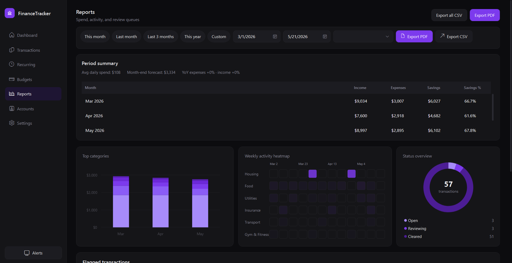

# FinanceTracker

A personal finance desktop app for Windows, built with WPF on .NET 8 and SQLite. It tracks transactions, accounts, budgets and recurring payments, and produces detailed reports. Everything runs locally, with no cloud account and no network access required.



## Features

**Dashboard**
- Animated KPI cards: net worth, monthly income, monthly expenses and savings rate, each with its change from last month
- Spending breakdown donut chart and a monthly cash-flow chart
- Recent transactions with category icons and color-coded amounts

**Transactions**
- Search and filter by category, date and type
- Add, edit and delete in a modal dialog, and mark transactions as recurring from the list
- A budget progress bar on each category row
- Export the current filtered view to CSV

**Recurring rules**
- Daily, weekly, monthly or yearly income and expense rules that can be paused and resumed
- Due transactions are created automatically at startup, with a toast and an entry in the notification center

**Budgets**
- Monthly limits per category, with progress bars marked safe, warning or over budget
- Alerts when spending reaches 80 percent and 100 percent of a limit
- A month navigator for reviewing earlier months

**Reports**
- Top categories for a single month, or a stacked chart across several months
- A 12-week activity heatmap by category
- Monthly income, expenses, savings and savings rate, average daily spend, a month-end forecast and a comparison with the same month last year
- Large or recurring expenses flagged for review, with their status (open, reviewing, cleared)
- Export to PDF (QuestPDF) or CSV, with account filters and date presets

**Accounts**
- Checking, savings, credit card, investment and cash accounts, each card showing a 30-day balance sparkline
- Multiple currencies (USD, EUR, GBP, CAD, AUD, JPY, CHF), converted to a base currency

**Settings**
- Accent color, font size and theme, applied immediately without a restart
- Currency, date format and first day of the week
- CSV import with a preview, plus database backup and restore

## Tech stack

| Layer        | Technology                                   |
| ------------ | -------------------------------------------- |
| UI           | WPF, .NET 8, C# 12                           |
| Architecture | MVVM with CommunityToolkit.Mvvm source generators |
| Data         | Entity Framework Core 8 with SQLite, code-first migrations |
| Charts       | LiveCharts2 (SkiaSharp)                      |
| PDF export   | QuestPDF                                     |
| DI           | Microsoft.Extensions.DependencyInjection     |
| Tests        | xUnit                                        |

## Project structure

```
FinanceTracker.sln
FinanceTracker/
  Data/            EF Core DbContext and migrations
  Models/          Transaction, Account, Category, Budget, RecurringRule
  Services/        Seeding, recurring rules, budget alerts, reports, settings, notifications
  ViewModels/      One view model per page plus the main shell
  Views/           XAML pages and dialogs
  Themes/          Color tokens and custom control templates
  Behaviors/       Animated number count-up
  Controls/        Loading shimmer
  Converters/      XAML value converters
FinanceTracker.Tests/   xUnit tests
docs/              Full technical documentation and screenshots
```

For a full description of the architecture, database schema, services and data flow, see [docs/documentation.md](docs/documentation.md).

## Getting started

### Requirements

- Windows 10 or 11
- [.NET 8 SDK](https://dotnet.microsoft.com/download/dotnet/8.0) or later

### Run

```powershell
git clone https://github.com/erdilatifi/FinanceTracker.git
cd FinanceTracker
dotnet run --project FinanceTracker
```

On first launch, the app creates its database at `%LOCALAPPDATA%\FinanceTracker\finance.db` and fills it with realistic demo data: 5 accounts, 16 categories, about 220 transactions over six months, 7 recurring rules and 72 budget records.

### Test

```powershell
dotnet test
```

### Publish

```powershell
dotnet publish FinanceTracker/FinanceTracker.csproj -c Release -r win-x64 --self-contained
```

## Keyboard shortcuts

| Shortcut               | Action                              |
| ---------------------- | ----------------------------------- |
| `Ctrl + N`             | New transaction                     |
| `Ctrl + E`             | Export the current view to CSV      |
| `Ctrl + 1` to `Ctrl + 7` | Dashboard, Transactions, Recurring, Budgets, Reports, Accounts, Settings |
| `Esc`                  | Close the open dialog or overlay    |

## License

Copyright (c) 2026 Erdi Latifi.

This project is source-available under the [PolyForm Noncommercial License 1.0.0](LICENSE). You may use, study and modify it for personal, educational and other noncommercial purposes. Commercial use is not permitted without written permission from the author.
